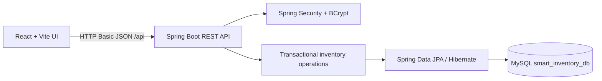

# Architecture

The frontend centralizes requests in `frontend/src/services/api.js`; Vite proxies `/api` to port 8080. Spring Security protects all API routes except health and login. MySQL entities and constraints are maintained through Hibernate schema updates. Stock movements run in a database transaction and acquire a pessimistic row lock on the product before calculating the new quantity. A transaction audit row records actor, reason, previous and resulting balances.

Stock status is computed from current quantity and each product's configured reorder and maximum levels. The reorder suggestion is `max(0, maxStockLevel - quantity)`. No consumption prediction is claimed because the current movement history does not yet model demand windows or seasonality.
