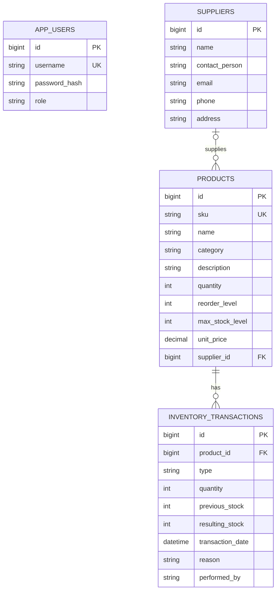

# Entity relationship diagram

JPA entities are defined in `backend/src/main/java/com/smartinventory/app/Domain.java`. Users are keyed by unique username; product SKU is unique. Supplier deletion clears product links. Product deletion is blocked when historical transactions exist.
